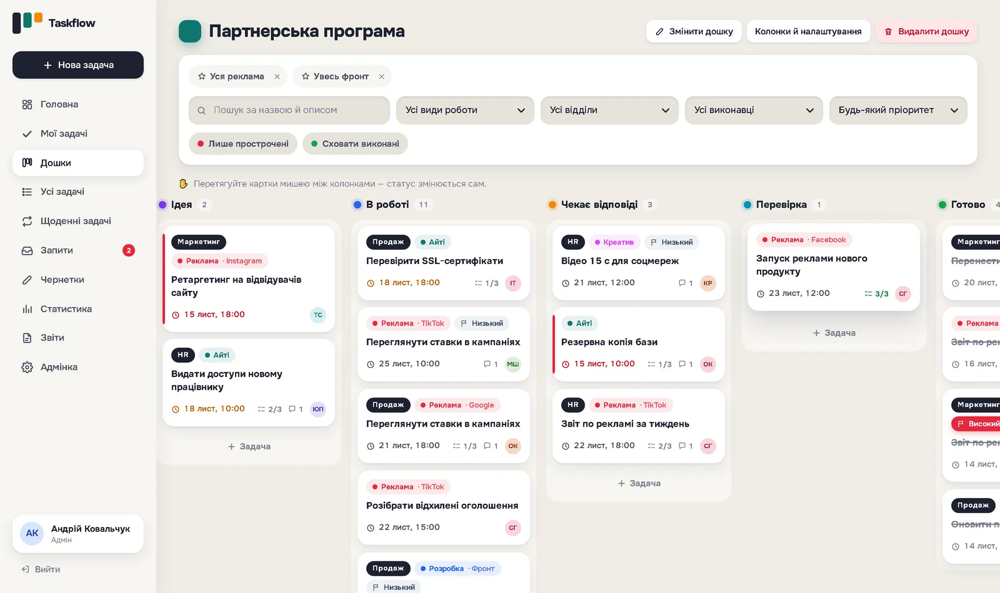
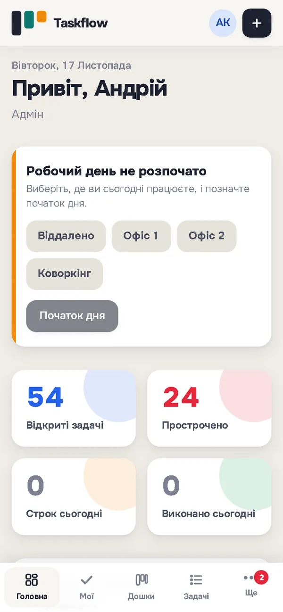

# Taskflow

Трекер задач для команди з кількох відділів. Дошки працюють як у Trello, а поверх них є те, чого Trello не вміє: рівні доступу, запити на погодження, щоденні задачі, звіти в PDF і Telegram-бот зі сповіщеннями.



## Можливості

- **Відділи й підтипи.** Розробка (з міткою «Фронт»), Реклама (рекламні мережі), Креатив, Айті. Списки редагуються в адмінці.
- **Чотири рівні доступу.** Виконавець, керівник групи, керівник відділу, адмін. Роль людини від рівня доступу не залежить. Усі правила зібрані в одному файлі, [`lib/access.ts`](lib/access.ts), і перевіряються на сервері в кожній дії.
- **Підзадачі.** У кожної свій виконавець і свій відділ, прогрес батьківської задачі рахується автоматично.
- **Запити.** Задача поза правами автора не губиться, а йде адміну на погодження. Адмін може схвалити як є або виправити й схвалити.
- **Щоденні задачі.** Картка на день створюється сама, історія виконання ведеться по днях.
- **У картці:** пріоритети з правилами перенесення строку, посилання з підписами, вкладення, чек-лист, @згадки, спостерігачі, нагадування, історія змін.
- **Робочий день.** Людина обирає місце роботи й відмічає початок і кінець дня. Це видно у звітах.
- **Статистика й звіти.** Графік виконаних задач, таблиця по людях, звіт по працівнику або по всій команді за період, з вивантаженням у PDF.
- **Telegram-бот.** Сповіщення про нові задачі, дедлайни, згадки й зміну статусу. Кнопки «Відкрити», «Виконано» або «На перевірку», «Прийняти» й «Нагадати через 1 год» прямо в повідомленні.
- **Адмінка:** люди й доступи, довідники, дошки й колонки, журнал дій, журнал входів.
- **Безпека:** обмеження спроб входу, сесії з пам'яттю пристроїв, CSP й інші заголовки, перевірка прав у кожній серверній дії.
- **Телефон.** Адаптивна верстка з нижньою панеллю, PWA (встановлюється на головний екран).

| Статистика | Телефон |
|---|---|
|  |  |

## Стек

- **Next.js 16** (App Router, Server Actions), **React 19**, **TypeScript**
- **Prisma 7** + **SQLite** (`better-sqlite3`)
- **Tailwind CSS v4**, перетягування карток — **dnd-kit**
- **PDFKit** для звітів, шрифт Onest (OFL)
- **Vitest** для юніт-тестів, **Playwright** для наскрізного прогону

## Запуск

Потрібен Node.js 20+.

```bash
npm install
cp .env.example .env               # задайте ADMIN_PASSWORD
npx prisma migrate deploy
npx prisma generate
npx prisma db seed -- --demo       # демо-команда: 12 людей, 82 задачі
npm run build && npx next start -p 3100
```

Відкрийте http://localhost:3100. Вхід адміна: `admin` і пароль з `.env`, у решти демо-людей пароль `demo12345` (логіни: `olena`, `dmytro`, `ivan`, `anna`…).

Без `--demo` сід створює лише довідники, порожні дошки й адміна.

Telegram-бот запускається окремим процесом: `npm run bot`. Для нього потрібен `TELEGRAM_BOT_TOKEN` у `.env`.

## Тести

- `npm test`: юніт-тести прав доступу, часу, статистики й паролів.
- `node scripts/e2e.mjs`: наскрізний прогін у браузері на запущеному застосунку зі свіжим `seed --demo`. Перевіряє вхід, права кожного рівня, запити, дошки, підзадачі, звіти й мобільну верстку. Змінює демо-базу.
- `npx tsx scripts/bot-smoke.ts`: перевірка бота на копії бази, без звернень до Telegram.

## Структура

| Шлях | Що там |
|---|---|
| `lib/access.ts` | усі правила: хто що бачить і може робити |
| `app/actions/*` | серверні дії, кожна заново перевіряє права |
| `app/(app)/*` | сторінки застосунку |
| `components/task/*` | канбан, картка, фільтри, форма задачі |
| `lib/reportPdf.ts`, `lib/teamReportPdf.ts` | PDF-звіти |
| `lib/telegram.ts`, `scripts/bot.ts` | бот |
| `prisma/seed.ts` | довідники й демо-дані |
