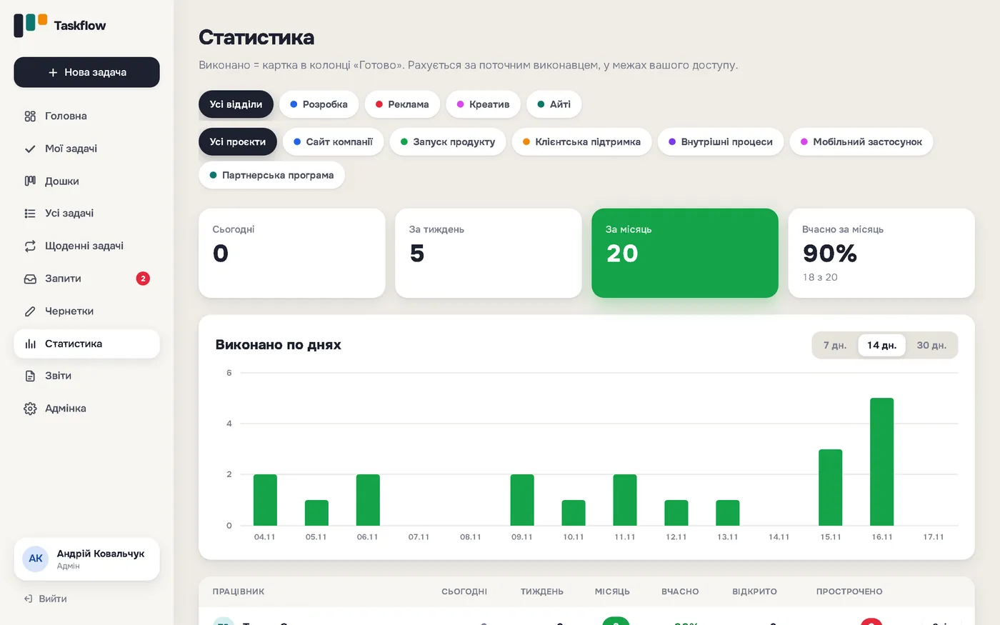

# Taskflow

A task tracker for a team with several departments. Boards work like Trello, and on top of them come the things Trello can't do: access levels, approval requests, daily tasks, PDF reports and a Telegram bot with notifications.

The interface is in Ukrainian.


## Features

- **Departments and subtypes.** Development (with a "Front-end" tag), Advertising (ad networks), Creative, IT. All lists can be edited in the admin panel.
- **Four access levels.** Assignee, team lead, department head, admin. A person's role doesn't depend on their access level. All rules live in one file, [`lib/access.ts`](lib/access.ts), and are checked on the server in every action.
- **Subtasks.** Each has its own assignee and department; the parent task's progress is calculated automatically.
- **Requests.** A task outside the author's permissions isn't lost: it goes to the admin for approval. The admin can approve it as is or edit and approve.
- **Daily tasks.** A card for the day is created automatically, and completion history is kept day by day.
- **Inside a card:** priorities with rules for moving deadlines, labeled links, attachments, a checklist, @mentions, watchers, reminders, change history.
- **Workday tracking.** People pick where they work today and mark the start and end of the day. This shows up in reports.
- **Statistics and reports.** A chart of completed tasks, a per-person table, a report for one person or the whole team over a period, exportable to PDF.
- **Telegram bot.** Notifications about new tasks, deadlines, mentions and status changes. "Open", "Done" or "Send for review", "Accept" and "Remind me in 1 h" buttons right in the message.
- **Admin panel:** people and access, dictionaries, boards and columns, action log, sign-in log.
- **Security:** sign-in attempt limiting, sessions with remembered devices, CSP and other headers, permission checks in every server action.
- **Phone.** Responsive layout with a bottom navigation bar, installable as a PWA.

| Statistics | Phone |
|---|---|
|  |  |

## Stack

- **Next.js 16** (App Router, Server Actions), **React 19**, **TypeScript**
- **Prisma 7** + **SQLite** (`better-sqlite3`)
- **Tailwind CSS v4**, drag and drop with **dnd-kit**
- **PDFKit** for reports, Onest font (OFL)
- **Vitest** for unit tests, **Playwright** for the end-to-end run

## Running locally

Requires Node.js 20+.

```bash
npm install
cp .env.example .env               # set ADMIN_PASSWORD
npx prisma migrate deploy
npx prisma generate
npx prisma db seed -- --demo       # demo team: 12 people, 82 tasks
npm run build && npx next start -p 3100
```

Open http://localhost:3100. Admin sign-in: `admin` with the password from `.env`. The other demo people use the password `demo12345` (logins: `olena`, `dmytro`, `ivan`, `anna`…).

Without `--demo`, the seed creates only the dictionaries, empty boards and the admin.

The Telegram bot runs as a separate process: `npm run bot`. It needs `TELEGRAM_BOT_TOKEN` in `.env`.

## Tests

- `npm test`: unit tests for access rules, time, statistics and passwords.
- `node scripts/e2e.mjs`: an end-to-end browser run against the running app with a fresh `seed --demo`. It covers sign-in, permissions at every level, requests, boards, subtasks, reports and the mobile layout. It modifies the demo database. Install Playwright with `npm i -D playwright`; the browser is taken from `CHROME_PATH` or an installed Google Chrome.
- `npx tsx scripts/bot-smoke.ts`: a bot check on a copy of the database, with no calls to Telegram.

## Structure

| Path | What's there |
|---|---|
| `lib/access.ts` | all rules: who can see and do what |
| `app/actions/*` | server actions; each one re-checks permissions |
| `app/(app)/*` | app pages |
| `components/task/*` | kanban, task card, filters, task form |
| `lib/reportPdf.ts`, `lib/teamReportPdf.ts` | PDF reports |
| `lib/telegram.ts`, `scripts/bot.ts` | the bot |
| `prisma/seed.ts` | dictionaries and demo data |
